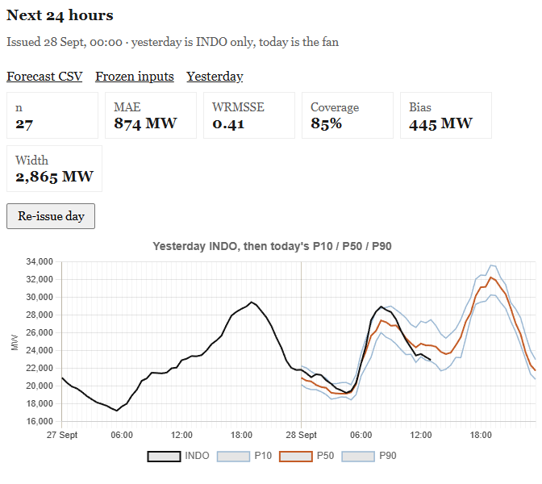

# GB National Demand forecast — systems architecture

**Status: complete.** Live **P10 / P50 / P90** forecast of Great Britain National Demand. Weather in, quantiles out, scored against Elexon Insights **INDO** after each settlement period. Built as a production service, not a notebook dump.

Source: [github.com/lbransby1/energy-forecast](https://github.com/lbransby1/energy-forecast). This document is the architecture view for software and ML engineering. Skills narrative: [`technical-writeup.md`](technical-writeup.md).

```
Open-Meteo (ERA5 / forecast / Previous Runs)     NESO ND (historic CSV)
                    \                                    /
                     \                                  /
                      v                                v
                 feature store (parquet)  <---- Insights INDO (live)
                              |
                              v
              LightGBM packs: hour | day | week
                              |
                              v
                    FastAPI  :8000
                    GET /           HTML dashboard (live / architecture / pipeline)
                    GET /board      local parquet JSON (fast path)
                    GET /shap       mean-tree SHAP from frozen rows
                    GET /drift      live-vs-holdout check (local file)
                    POST /capture   issue forecasts (slow path)
                              |
                              v
                 data/live/board.parquet + frozen features
```

---

## 1. Problem and product

| Preset | Issue rule | Model pack | Horizon |
|---|---|---|---|
| **next30** | every half-hour (:10 / :40 London) | hour (ERA5 + `lag_1`/`lag_2`) | next settlement period |
| **day** | midnight London, freeze | day (Previous Runs) | 24 h |
| **week** | Monday 00:00 London, freeze | week v3 (Previous Runs, Optuna, no `lag_48`) | 168 h |

The live contract: **write the forecast first**, join INDO only after that period has ended. Holdout MAE is not the score that matters; the board is. Yesterday is **INDO only** (what happened). Today is the **issued fan** (P10 / P50 / P90). Elapsed hours of today get a black INDO overlay as Insights publishes. The day pack is not seeded with yesterday’s predictions; it runs forward from the midnight freeze.

The dashboard has three tabs. **Live board** is the charts; scores (this freeze and last-train holdout) sit in dropdowns; **Earlier / Today / Later** pages past issued windows. **Model Architecture** is training plus three SHAP columns. **Data Pipeline and Maintenance** is ingestion → processing → issue/freeze/score → API, plus drift status. There is no after-the-fact review tab. `GET /board`, `GET /shap`, and `GET /drift` never call weather APIs. The capture loop issues due forecasts; the page has no reload or “issue due” button.

Live demo: [energy-forecast-production.up.railway.app](https://energy-forecast-production.up.railway.app)



*Day freeze, 28 Sept 2026 ~13:00 London. n = 27 scored half-hours so far; MAE 874 MW; WRMSSE 0.41; 80% interval coverage 85%; bias +445 MW. Grey/black before midnight is yesterday’s outturn, not a hindcast.*

Regional / GSP series are out of scope: there is no public live actual.

---

## 2. Runtime architecture

### 2.1 Process

One **uvicorn** worker (file-backed state is not safe across multiple writers). FastAPI lifespan starts a capture loop. `EF_SKIP_CAPTURE=1` disables it (tests).

| Path | Cost | Does |
|---|---|---|
| `GET /` `GET /health` | milliseconds | HTML / `{ok: true}` |
| `GET /board` | local parquet | charts + MAE/coverage; **no Insights/Open-Meteo** |
| `GET /shap` | local parquet + trees | mean-tree SHAP for hour/day/week; **no weather APIs** |
| `GET /drift` | local `drift.json` | last live-vs-holdout check; **no weather APIs** |
| `POST /capture` | seconds–tens of seconds, **background thread** | weather fetch, LightGBM, freeze, INDO join, WRMSSE cache, drift check |

WRMSSE needs 56 days of INDO. It is computed on the **capture loop**, cached in `data/live/wrmsse_cache.json`, and only *read* on `/board`.

### 2.2 Data plane

```
data/raw/demanddata_*.csv     historic ND (committed; Docker/Railway image)
data/models/{hour,day,.}/     LightGBM artefacts (~20 MB, committed)
data/processed/               INDO + weather caches (volume, gitignored)
data/live/                    board, archive, frozen snapshots (volume, gitignored)
```

INDO cache writes are **atomic** (temp + `os.replace`) and **locked** so `/board` and capture cannot tear the parquet.

### 2.3 Time

Settlement timestamps are **Europe/London** period starts, including DST 46/50-period days. INDO for period `T` exists only after `T+30min`. Joins are exact timestamp, not hour-floor, when `settlement_period` is present.

---

## 3. ML architecture

Two-phase LightGBM: **mean** booster, then **residual quantiles** P10/P50/P90. P50 is not the mean. Interval scale targets ~80% coverage; the week fan **widens with lead**.

| Pack | Weather in train | Short lags | Live route |
|---|---|---|---|
| Hour (Optuna) | ERA5 | last published INDO (`lag_1` / `lag_2`) | `lead ≤ 1 h` |
| Day | Previous Runs | yesterday known (`lag_48`) | `1 < lead ≤ 24 h` |
| Week v3 | Previous Runs | no `lag_48`; week-over-week weather + 14d / 3-week demand extras; **direct** predict | `lead > 24 h` |

COVID years 2020–2023 are out of day/week training. Hour pack may use 2022–2023.

**Leakage rule:** day/week holdout weather is Previous Runs (what would have been available at issue), not perfect ERA5.

Features: calendar + UK holidays, HDD/CDD (15.5 °C), weather trajectory (past rolls + **forward** 12h/24h on the forecast path). Hour also uses lags 1/2. Day uses 48/336. Week v3 drops yesterday (`lag_48`) and adds `temp_delta_7d`, 14-day / 3-week demand extras. Climatology fills only 48/336. Holiday extra flags were tried and **reverted** — trees still followed `lag_48` on the day after a bank holiday. Later day-pack experiments (yesterday deltas, 24h deltas, MAE+tail quantiles) sit under `notebooks/day/` and were **not** promoted: live freeze MAE was worse than production.

Eval: 56-day holdout at display frequency; WRMSSE vs weekly seasonal naive (1.0 = copy last week); skill vs climatology; SHAP on mean/P10/P90 of the pack that scored the row; case notebook for holiday / clock-change / hot day.

**Optuna:** `notebooks/06_optuna.ipynb` sets `PRODUCT` to `next_hour`, `short`, or `medium` (run Search once per pack). Studies resume from `data/processed/optuna_{product}.db`. Optional W&B: `pip install -e ".[tracking]"`, `wandb login`, leave `USE_WANDB = True`. After a study, `write_optuna_snapshot()` refreshes `data/models/optuna_studies.json`. Production **hour** and **week v3** trees are Optuna winners; the day pack is still stock LightGBM.

---

## 4. Live scoring and safety

- **Frozen feature parquet** at issue: weather, lags, last INDO. Day/week overwrites are the trial; week re-issue requires `WEEK_REISSUE_PASSWORD`.
- **Context INDO** (`data/live/context_actuals.parquet`): last week of published outturn, written on the capture loop so a cold volume still shows yesterday / last week as the grey line. `GET /board`, `GET /shap`, and `GET /drift` only read local files.
- Hour pack **stamps `lag_1`/`lag_2` from Insights** immediately before predict. The 30-minute call is skipped unless both prints exist and the latest is under 90 minutes old. Issues without those lags are dropped from the board and scores. Production trees are the Optuna `next_hour` winner.
- Capture at **:10 and :40** so the previous SP is usually published.
- **Drift check** (`energy_forecast.drift`): after each capture tick, compare this-freeze MAE and 80% coverage with the last-train holdout. Alert if live MAE is ≥ **1.5×** holdout, or coverage falls below **55%**, once there are enough scored half-hours (next30 n≥12, day n≥8, week n≥24). The same pack and kind wait **12 hours** before mailing again. Status is on the pipeline tab and `GET /drift` (`data/live/drift.json`). Mail is optional — see **Drift mail on Railway** below.

---

## 5. HTTP API

| Method | Path | Notes |
|---|---|---|
| GET | `/` | Dashboard (live board, model architecture, data pipeline) |
| GET | `/health` | Railway healthcheck |
| GET | `/board` | Fast JSON; **no Insights/Open-Meteo** |
| GET | `/shap` | Mean-tree SHAP from frozen rows; **no weather APIs** |
| GET | `/drift` | Last live-vs-holdout check; **no weather APIs** |
| GET | `/download/{preset}` | Forecast CSV |
| GET | `/download/{preset}/frozen` | Frozen inputs |
| GET | `/inputs/{preset}` | Input check (may hit Insights) |
| POST | `/capture` | Due presets (`LIVE_TOKEN` if set) |
| POST | `/capture/{preset}` | Force one pack; week needs `X-Week-Password` |

---

## 6. CI/CD and deploy

**GitHub Actions** (`.github/workflows/ci.yml`): Python 3.11, `pip install -e ".[dev]"`, `pytest`.

**Railway** (Dockerfile):

1. New project → Deploy from GitHub repo.
2. Builder: Dockerfile (`railway.toml`).
3. Volume mount `data/live` (and optionally `data/processed`) so the board survives deploys.
4. Variables: `WEEK_REISSUE_PASSWORD`, optional `LIVE_TOKEN`, optional drift-mail set below, `PORT` (Railway injects this).
5. Healthcheck: `GET /health`.

First capture on a cold box fetches weather and is slow. The **website** stays fast because `/`, `/board`, `/shap`, and `/drift` do not wait on that.

### Drift mail on Railway

The check always runs on the capture loop. Until SMTP is set it only writes `data/live/drift.json` (pipeline tab still updates). To email you:

1. Open the Railway project → the **forecast** service → **Variables**.
2. Add:

| Variable | Example (Gmail) |
|---|---|
| `DRIFT_EMAIL_TO` | your inbox |
| `DRIFT_EMAIL_FROM` | same as the SMTP user, or a labeled from-address |
| `DRIFT_SMTP_HOST` | `smtp.gmail.com` |
| `DRIFT_SMTP_PORT` | `587` (STARTTLS) or `465` (SSL) |
| `DRIFT_SMTP_USER` | the Gmail address |
| `DRIFT_SMTP_PASSWORD` | a [Gmail app password](https://myaccount.google.com/apppasswords), not the account password |

3. Redeploy or wait for the next restart so the process sees the variables. The next `:10` / `:40` tick arms mail. `GET /drift` then has `"email_ready": true`.
4. Confirm on **Data Pipeline and Maintenance** — the drift table is the last check. A test alert is not sent unless a pack is actually 1.5× holdout or under 55% coverage.

Outlook/Office 365: host `smtp.office365.com`, port `587`. Other hosts work if they speak SMTP on 587 or 465. Keep the password in Railway variables only; do not commit it.

Local:

```bash
python -m venv .venv
.venv\Scripts\activate
pip install -e ".[dev]"
pytest -q
uvicorn energy_forecast.app:app --host 127.0.0.1 --port 8000
```

Docker:

```bash
docker compose up --build
```

---

## 7. Holdout snapshot (not the live board)

| Pack | Horizon | Holdout MAE | RMSE | 80% coverage | WRMSSE | Width |
|---|---|---:|---:|---:|---:|---:|
| Hour (Optuna) | next 30 min | 264 MW | 341 MW | 77% | 0.12 | 840 MW |
| Day | 24 h | 851 MW | 1,130 MW | 81% | 0.38 | 2,896 MW |
| Week v3 | 7 d | 1,118 MW | 1,528 MW | 77% | 0.51 | 3,449 MW |

---

## 8. Layout

```
src/energy_forecast/    library + FastAPI app
  app.py                dashboard (three tabs) + HTTP
  live.py               capture loop, board, freeze, scores
  drift.py              live-vs-holdout check + optional SMTP
  forecast.py / model.py / features.py / evaluate.py
  explain.py            GET /shap
  lab.py                holdout cards + Optuna snapshot
tests/                  pytest (no live APIs)
notebooks/              EDA → train → eval → Optuna → SHAP → cases
notebooks/day/          day pack experiments (v1–v4, not promoted)
notebooks/week/         week pack experiments (v1–v3)
docs/                   README figures (live board screenshot)
data/models/            committed hour / day / week trees
data/raw/               NESO ND CSVs
data/live/              runtime board, frozen rows, drift.json (gitignored)
.env.example            LIVE_TOKEN, week password, drift SMTP
.github/workflows/ci.yml
Dockerfile  railway.toml  docker-compose.yml
```
